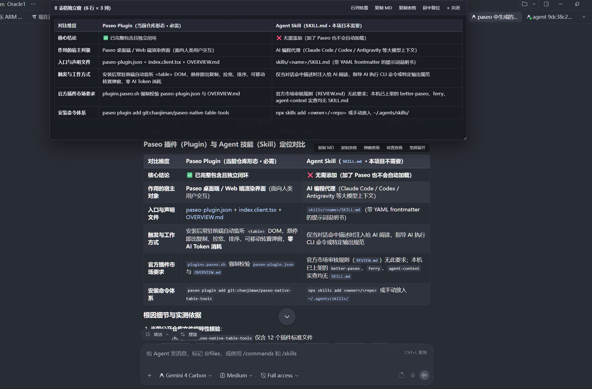

# Paseo Native Table Tools

[English](README.md) | [简体中文](README.zh-CN.md)

Zero-intrusion enhancements for native Markdown tables in [Paseo](https://paseo.sh) Desktop and Web. **Does not replace assistant reply rendering**, preserving 100% of Paseo's built-in side-by-side workspace file links and native text selection, while fixing leftward overflow on long user message bubbles.



## Features

- **One-click table copy**: Hover any Markdown table to copy clean GitHub Flavored Markdown (`Copy MD` / `复制 MD`) or tab-separated values (`Copy TSV` / `复制表格`) ready for Excel, Google Sheets, WPS, or Feishu/Lark.
- **Draggable & resizable floating table viewer**: Click `Pop out` (`弹窗查看`) or `Transpose` (`转置查看`) to inspect wide tables in a non-modal floating window without blocking chat scrolling. Drag the header to reposition, drag the bottom-right corner to resize, sort or resize columns inside the window, and flip between original and transposed orientations anytime.
- **Smart height cap & sticky headers**:
  - Prevents narrow, stretched-out columns by keeping table headers `nowrap` by default.
  - Caps tall multi-row tables at `min(62vh, 520px)` with smooth internal scrolling, theme-aware sticky headers, and a one-click `Full height` / `Cap height` toggle.
- **Unit-aware 3-state column sorting**: Click any column header to cycle `Ascending ▲ -> Descending ▼ -> Original order`. Automatically converts and compares matching units (`ms`/`s`, `Mbps`/`Gbps`, `KB`/`MB`/`GB`, numeric ranges, and percentages) while keeping empty placeholders (`-`, `N/A`, `无`) at the bottom.
- **Manual column resize & wide mode**: Drag any header's right edge to resize individual columns (double-click the edge or click `Reset widths` to restore), or toggle `Expand width` for horizontal scrolling.
- **Quick cell copy**: Double-click any data cell or `Alt + Click` any cell to copy its plain text.
- **Built-in English & Simplified Chinese UI**: Automatically follows your Paseo app language (`en` and `zh-CN`) in real time.
- **Long user bubble overflow fix**: Constrains wide pasted text and URLs inside user message bubbles across both native Paseo rows and Better Paseo plugin rows.

## Installation

```bash
# Once listed on plugins.paseo.sh
paseo plugin add chaojiman/paseo-native-table-tools

# Or install directly from GitHub on macOS, Windows, or Linux
paseo plugin add git:chaojiman/paseo-native-table-tools
```

## Local Development

```bash
npm install
npm run typecheck
npm test

paseo plugin install /absolute/path/to/paseo-native-table-tools
paseo plugin reload paseo-native-table-tools
```

## License

MIT
