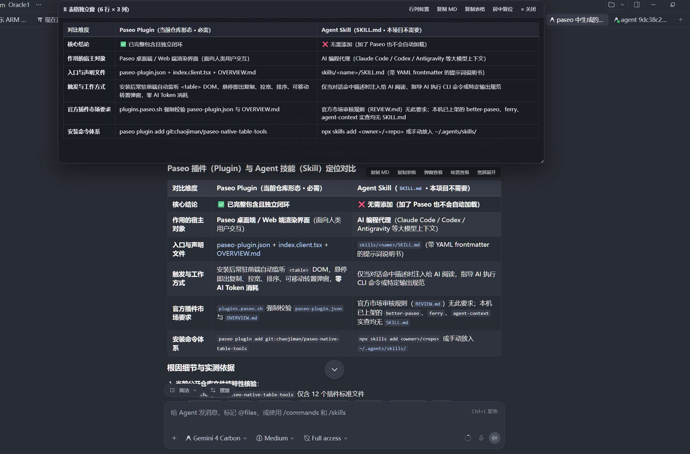

# Paseo 原生表格增强（Native Table Tools）

[English](README.md) | [简体中文](README.zh-CN.md)

为 [Paseo](https://paseo.sh) 桌面端与 Web 端原生 Markdown 表格提供零侵入增强，**不接管聊天回复渲染**，100% 保留 Paseo 原生侧边栏分屏打开文件链接与语义化选区复制，并修复用户超长消息气泡向左溢出的问题。



## 功能特性

- **一键复制整表**：悬停任意 Markdown 表格，右上角悬浮工具条提供 `复制 MD`（合法 GFM 源码）与 `复制表格`（TSV，直接粘贴进 Excel / WPS / 飞书自动分列）。
- **可拖拽、可缩放独立弹窗查看 & 转置查看**：悬停表格点击 `弹窗查看`（保持原方向）或 `转置查看`（自动行列互换）打开无遮罩悬浮窗，不挡底部对话滚动与复制；按住顶部标题栏任意拖动位置，拖动右下角自由调整窗口大小，支持窗内排序、拉宽列、一键互切方向与 `居中复位`。
- **智能防超高 + 吸顶表头**：
  - **防假高（窄列折行）**：表头默认 `white-space: nowrap` 自动撑出合理可读列宽，消除列过窄导致的“细长面条表”。
  - **限真高（多行长表）**：长表自动限制最大高度 `min(62vh, 520px)` 并在内部滚动，表头随深浅色主题 `sticky` 吸顶固定；当超过最大高度时工具条自动提供 `展开全高` / `限制高度` 一键切换。
- **表头智能三态排序**：单击任意表头按 `升序 ▲ → 降序 ▼ → 恢复原序` 循环；自动识别并换算同维度单位（`ms`/`s`、`Mbps`/`Gbps`、`KB`/`MB`/`GB`、区间值、百分比），空值与占位符始终沉底。
- **手动拖拽拉宽列 & 宽屏展开**：拖动表头右边缘自由调宽，双击右边缘或点 `重置列宽` 恢复；点 `宽屏展开` / `恢复紧凑` 一键切换整表横向舒展模式。
- **一键复制单元格**：双击任意数据单元格，或 `Alt + 单击` 任意单元格即刻复制纯文本。
- **中英双语界面自适应**：内置简体中文与英文 UI 文案，实时跟随 Paseo 客户端语言设置无缝切换。
- **用户长消息防左溢出**：同时覆盖 Paseo 原生与 Better Paseo 插件提问气泡，超长文本与 URL 自动折行，避免向左侧溢出截断。

## 安装方式

```bash
# 从 Paseo 官方插件市场直接安装（paseo.sh/plugins）
paseo plugin add chaojiman/native-table-tools

# 或直接从 GitHub 安装最新 main 分支（macOS / Windows / Linux）
paseo plugin add git:chaojiman/paseo-native-table-tools
```

## 本地开发与调试

```bash
npm install
npm run typecheck
npm test

# 从本地目录安装并热重载
paseo plugin install /absolute/path/to/paseo-native-table-tools
paseo plugin reload paseo-native-table-tools
```

## 开源许可

MIT
